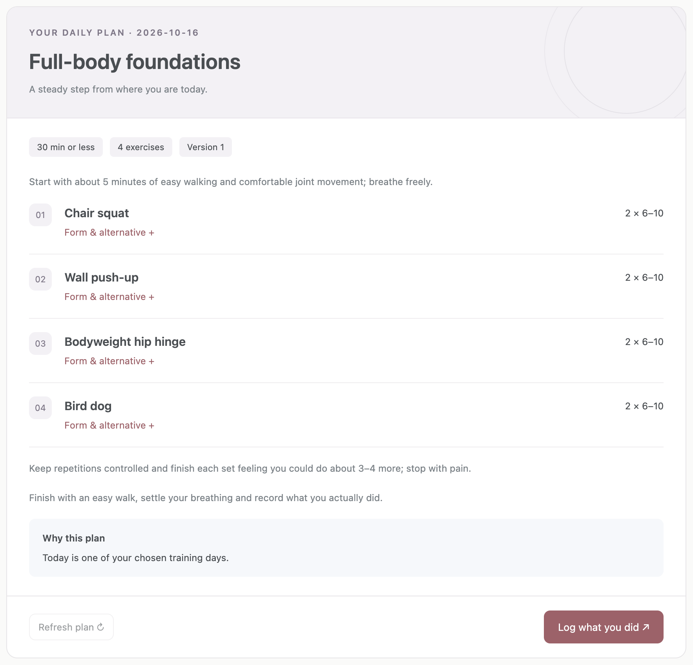
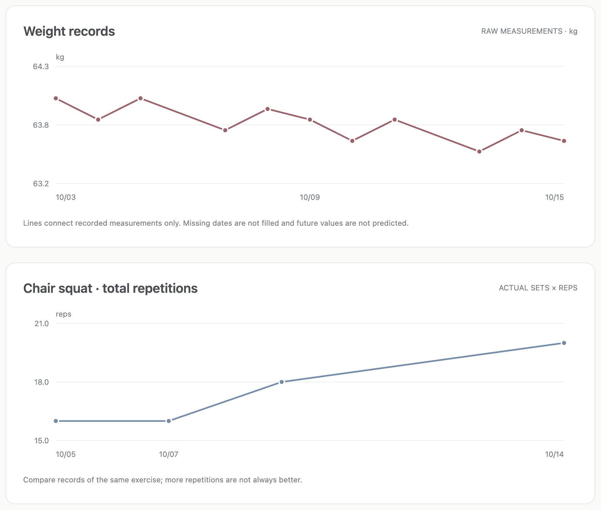

# AI4薄肌

**A personal training companion powered by Codex. Remember your starting point and make daily guidance traceable.**

[中文（默认）](README.md) · English

AI4薄肌 is a local-first system for adult fitness beginners. Create a profile through the dashboard or Codex, record actual activity, retain long-term memory, generate explainable starter plans, and visualize progress. The product title remains **AI4薄肌** in every language.

<a href="docs/previews/plan-en-hd.png"></a>

Synthetic demo data. Click the focused plan image for the full-resolution original, or explore the [complete dashboard](https://selen-suyue.github.io/ai4boji/demo/). The app still opens in Chinese by default.

<details>
<summary>View high-resolution progress charts</summary>

<a href="docs/previews/progress-en-hd.png"></a>

</details>

The muted blue, purple and rose accent families follow the [personal homepage](https://selen-suyue.github.io/). [Design notes](docs/design.md) · [Progress preview](docs/previews/progress-en-hd.png).

## Online

[Project website](https://selen-suyue.github.io/ai4boji/) · [Read-only demo](https://selen-suyue.github.io/ai4boji/demo/) · [60-second film](https://selen-suyue.github.io/ai4boji/#film)

The public site uses synthetic data only. Run the full personal workflow locally.

## Quick preview

Requires **Python 3.9+**. No third-party Python packages, Node.js runtime, or additional model API key is needed for the app. Codex access and usage requirements still apply. The first preview is in Chinese; switch to English to persist that display choice.

Download or clone this repository, then run from its root:

```bash
python3 -m ai4boji serve --demo
```

Open the printed address, normally <http://127.0.0.1:8765>. If occupied, use `python3 -m ai4boji serve --demo --port 18765`.

The preview creates **synthetic data** under `.demo/`: two weeks of records, a current plan and a sample memory. Personal `data/` is separate. Stop with `Ctrl+C`; records persist.

## Personal use

```bash
python3 -m ai4boji serve
```

1. **Profile:** enter a name, age, goal, available time, 1–3 weekdays, equipment, timezone, food context and exercise restrictions.
2. **Check-in:** report sleep, energy, soreness, available time and pain. Missing values remain unknown.
3. **Daily plan:** save the check-in to generate activity, sets/reps, rest, form cues, alternatives and reasons.
4. **Actual activity:** log outcome, minutes and optional sets, measurements or notes. Correct records when needed.
5. **Progress:** review the calendar, weight records, chair-squat repetitions, two-week reflection and planning rationale.
6. **Continuity:** restart the app or begin a new Codex conversation with the same database directory.

Dates follow the profile’s IANA timezone (default `Asia/Shanghai`), independently of language. v0.1 uses kg, cm and minutes.

## Use with Codex

Open this repository as a Codex project. The repository-local skill lives at `.agents/skills/ai4boji/SKILL.md`; `AGENTS.md` explains how to use it. In a new project conversation, try:

> Use $ai4boji. Read my profile and current plan first. I have 20 minutes today, slept 7 hours, energy is 4/5, soreness is 1/5, and I have no pain. Update today’s guidance.

> Use $ai4boji to record 18 minutes of training today: 2 sets of 8 bodyweight chair squats, effort 5/10. Leave unreported details unknown.

> Use $ai4boji to remember that I prefer morning training on weekends. Review the last two weeks and explain the evidence behind your next suggestion.

The skill reads `context`, converts reported information into validated JSON, calls the CLI and verifies the saved result. **Codex handles natural language; the dashboard does not contain a separate chat model.** No global skill install or global configuration change is required. If your client does not discover the skill automatically, ask it to read the repository’s `SKILL.md` explicitly.

Detailed guide: [English](docs/en/usage.md) · [中文](docs/zh-CN/usage.md).

## Complete CLI example

Use an isolated directory for these synthetic examples. Global options precede the subcommand.

```bash
python3 -m ai4boji --data-dir work/tryout profile --input examples/profile.json
python3 -m ai4boji --data-dir work/tryout checkin --input examples/checkin.json
python3 -m ai4boji --data-dir work/tryout --lang en plan
python3 -m ai4boji --data-dir work/tryout log --input examples/log.json
python3 -m ai4boji --data-dir work/tryout --lang en context
python3 -m ai4boji --data-dir work/tryout --lang en report --days 7 --format markdown
```

Examples omit dates to use today in the profile timezone. A recovery plan is expected when today is not a chosen training weekday. Actual activity can differ from the plan.

| Command | Purpose |
| --- | --- |
| `profile --input file.json` | Create or partially update a profile |
| `checkin --input file.json` | Replace a dated check-in using a stable daily ID |
| `plan --date YYYY-MM-DD` | Generate/update a plan; identical inputs keep its version |
| `log --input file.json` | Save actual activity; retry the same ID without double-counting |
| `memory --input file.json` | Save a fact, preference or AI inference |
| `context` | Compact Codex context with recent records and active memories |
| `state` | Full bilingual dashboard data |
| `history ID` | Read earlier revisions of a record |
| `forget memory:ID` | Permanently remove a memory and its revisions |
| `report --days 7 --format markdown` | Evidence-linked reflection |
| `export` | Export all current records as JSON; not a full database backup |

Omitting `--input`, or passing `--input -`, reads JSON from stdin. Commands return JSON; validation failures use stderr and exit code 2. See [schemas/records.json](schemas/records.json).

## Personalization in v0.1

- Structured weekdays, equipment, time, sleep, energy, soreness, pain and recent activity determine the daily starter plan.
- Completed training today, training yesterday, fatigue or very short availability can switch the plan to recovery.
- Pain or an exercise restriction pauses automatic strength planning. Old pain does not disappear just because it falls outside the recent-record window.
- A small conservative exercise catalog provides cues and alternatives. Loads are not automatically increased.
- Plans retain rule version, profile version, input fingerprint and source IDs. Changed evidence marks an existing plan stale.

Goals, food context and free-text memories are available to **Codex** for interpretation. The local rules do not pretend to understand that text or generate personalized calorie prescriptions. Goal-specific phases, progressive loading and automatic weekly changes are future work.

## Memory and privacy

- Default storage is `data/ai4boji.sqlite3` under the **current working directory**. Always reuse that directory or pass an absolute `--data-dir`.
- Facts, preferences and AI inferences are separate. Inferences cannot be marked user-confirmed. Memories can expire, be corrected or be deleted.
- Edits retain versions. Dashboard writes use optimistic revision checks to avoid silently overwriting another session’s changes.
- Personal databases, `.demo/`, environment files and `data/` are ignored by Git. Checked-in examples are synthetic.
- The server listens only on `127.0.0.1`, without telemetry or background uploads. Do not expose it publicly.
- Local storage does not mean local model inference. Content given to Codex enters the relevant model-processing workflow.
- SQLite is not encrypted by this application. OS access controls and disk encryption are environment responsibilities. Memory deletion does not erase external backups or existing conversations.
- For a complete backup, stop the server and copy the private data directory. JSON export contains current records only; there is no import UI in v0.1.

## Structure

```text
ai4boji/
├── README.md / README.en.md
├── AGENTS.md
├── .agents/skills/ai4boji/  # Codex workflow and JSON reference
├── ai4boji/
│   ├── __main__.py         # CLI
│   ├── core.py             # Validation, planning, context and reflection
│   ├── storage.py          # SQLite, revisions and deletion
│   ├── catalog.py          # Bilingual exercise cards and copy
│   ├── server.py           # Loopback HTTP API
│   └── web/                # Buildless bilingual dashboard
├── schemas/
├── knowledge/
├── docs/zh-CN/ / docs/en/
├── examples/               # Synthetic inputs
└── tests/
```

## Development

```bash
python3 -m unittest discover -s tests -v
```

Tests use temporary databases and cover the complete workflow, cross-process persistence, retries, corrections, revision conflicts, stale plans, pain handling, timezones, language parity and local HTTP boundaries. HTTP tests require permission to bind a local port. CI runs on Python 3.9 and 3.12.

Optional JavaScript syntax check: `node --check ai4boji/web/app.js`. Node is not required to use the application.

## Roadmap and scope

- **v0.1 (current):** profile → check-in → daily plan → actual records → durable context → basic visualization.
- **v0.2:** weekly plans, phase reviews, progression rules, editable plans and memory conflict handling.
- **v0.3:** more exercises/metrics, import, optional scheduling and MCP.
- **v1.0:** professional content review, stable migrations, backup/restore and release workflow.

v0.1 has no background reminders, wearable connections, photo-based body-fat estimation, medical/rehabilitation prescriptions or cloud synchronization. Starter rules have not been clinically validated. See [sources and scope](knowledge/README.md).

Contributions should preserve the title **AI4薄肌**, Chinese-first preview, bilingual behavior and the distinction between reported facts and inference. Use synthetic data in issues and screenshots, and run the test suite before submitting changes.

License: [MIT](LICENSE).
