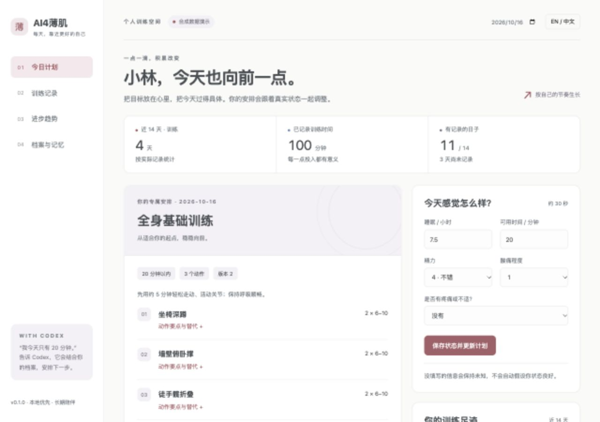

# AI4薄肌

**由 Codex 驱动的个人薄肌训练伙伴。记住你的起点，让每天的安排有据可依。**

中文（默认） · [English](README.en.md)

AI4薄肌 为成年健身新手提供一个本地优先的训练系统：通过网页或 Codex 建档，记录实际状态和训练，保存长期记忆，生成可解释的起步安排，并用图表观察变化。所有语言下的项目标题都为 **AI4薄肌**。



配色沿用[个人主页](https://selen-suyue.github.io/)的灰蓝、灰紫、灰玫瑰三组强调色；[设计说明](docs/design.md) · [趋势页预览](docs/previews/progress-zh.jpg)。

## 在线体验

[项目网站](https://selen-suyue.github.io/ai4boji/) · [只读演示](https://selen-suyue.github.io/ai4boji/demo/) · [60 秒宣传片](https://selen-suyue.github.io/ai4boji/#film)

线上仅展示合成数据。完整个人工作流在本地运行，详见下方快速开始。

## 30 秒预览

需要 **Python 3.9+**，不需要安装第三方 Python 包、Node.js 或额外配置模型 API Key。首次页面默认为中文，可切换 English 并记住选择。Codex 自身的访问与使用要求仍适用。

下载或克隆本仓库，在仓库根目录运行：

```bash
python3 -m ai4boji serve --demo
```

浏览器打开终端打印的地址，默认是 <http://127.0.0.1:8765>。端口被占用时：

```bash
python3 -m ai4boji serve --demo --port 18765
```

演示会在 `.demo/` 中创建**合成数据**，含两周记录、今日计划和一条示例记忆。它不会写入个人 `data/`。按 `Ctrl+C` 停止服务；数据会保留。

## 开始真实使用

```bash
python3 -m ai4boji serve
```

1. **建档**：称呼、年龄、目标、可用时间、1–3 个训练日、器械、时区、饮食条件和运动限制。
2. **今日状态**：填写实际睡眠、精力、酸痛、可用时间与疼痛情况；未填写的信息保持未知。
3. **每日指导**：保存状态并生成计划，查看动作、组次、休息、要点、替代方式与安排依据。
4. **记录实际完成**：保存日期、完成情况、分钟数、可选的组次、体重、腰围、感受；支持更正。
5. **查看变化**：浏览日历、体重曲线、坐椅深蹲完成次数、两周回顾和计划依据。
6. **持续使用**：关闭服务或重新打开 Codex 会话后，继续读取同一目录中的 SQLite 数据库。

日期按档案里的 IANA 时区计算，默认 `Asia/Shanghai`。语言和时区独立设置。当前单位固定为 kg、cm、分钟。

## 与 Codex 搭配

把本仓库作为 Codex 项目打开。仓库内提供 `.agents/skills/ai4boji/SKILL.md`，并由 `AGENTS.md` 说明调用规则。在新的项目会话中可以直接说：

> 使用 $ai4boji，先读取我的档案和当前计划。我今天只有 20 分钟，昨晚睡了 7 小时，精力 4/5，酸痛 1/5，没有疼痛。帮我更新今天的安排。

> 使用 $ai4boji，记录今天实际练了 18 分钟：坐椅深蹲 2 组，每组 8 次，徒手；整体难度 5/10。没有提到的项目不要替我补齐。

> 使用 $ai4boji，记住我周末更喜欢上午训练。看看最近两周的记录，解释下一步建议的依据。

Skill 会先执行 `context`，将自然语言整理为经过校验的 JSON，调用 CLI，再读回验证结果。**自然语言理解由 Codex 完成；本地网页不内置另一个聊天模型。** 不需要全局安装 Skill，也不会修改用户的全局 Codex 配置。如果当前客户端没有自动发现仓库 Skill，可直接要求它读取该 `SKILL.md` 再执行。

完整操作协议：[中文](docs/zh-CN/usage.md) · [English](docs/en/usage.md)。

## CLI 最短完整流程

以下示例全部是合成输入。先在独立目录中运行，避免覆盖个人档案。全局参数放在子命令之前。

```bash
python3 -m ai4boji --data-dir work/tryout profile --input examples/profile.json
python3 -m ai4boji --data-dir work/tryout checkin --input examples/checkin.json
python3 -m ai4boji --data-dir work/tryout plan
python3 -m ai4boji --data-dir work/tryout log --input examples/log.json
python3 -m ai4boji --data-dir work/tryout context
python3 -m ai4boji --data-dir work/tryout report --days 7 --format markdown
python3 -m ai4boji --data-dir work/tryout --lang en context
```

示例不指定日期，使用该档案所在时区的今天。若今天不是设定训练日，输出恢复日是正常行为。日志中的实际训练可以与计划不同，系统记录真实反馈。

| 命令 | 用途 |
| --- | --- |
| `profile --input file.json` | 创建或部分更新个人档案 |
| `checkin --input file.json` | 保存指定日期的状态；同日使用固定 ID |
| `plan --date YYYY-MM-DD` | 生成/更新计划，相同输入不新增版本 |
| `log --input file.json` | 保存实际记录；同一 `id` 重试不重复计数 |
| `memory --input file.json` | 保存事实、偏好或 AI 推断 |
| `context` | 给 Codex 的精简上下文，含档案、计划、近期记录、有效记忆 |
| `state` | 完整双语界面数据 |
| `history ID` | 查看一条记录的历史版本 |
| `forget memory:ID` | 永久删除指定记忆及其历史版本 |
| `report --days 7 --format markdown` | 可追溯的回顾报告 |
| `export` | 导出全部当前记录的 JSON（不是完整数据库备份） |

`--input -` 或省略 `--input` 表示从标准输入读取 JSON。输出为 JSON；错误写入 stderr，退出码为 2。完整数据协议见 [schemas/records.json](schemas/records.json)。

## v0.1 如何个性化

- 使用训练日、器械、时间、当日精力/睡眠/酸痛、疼痛与近期实际训练决定当天安排。
- 训练已经完成、昨天有训练、状态疲惫或时间很短时，安排恢复。
- 疼痛或运动限制存在时，暂停自动力量计划；历史疼痛不会因为超过一周而自动消失。
- 动作库采用少量保守起步动作，包含要点与替代方式；不自动递增重量。
- 每份计划保存规则版本、档案版本、输入摘要和来源 ID；数据改变后旧计划会标记“需要更新”。

目标、饮食习惯和文字记忆会提供给 **Codex** 理解；本地规则引擎不会声称已经理解这些自由文本，也不会自动生成个性化热量处方。首版适合建立基础流程，更细致的目标阶段、自动渐进负荷与周计划调整属于后续版本。

## 记忆与隐私

- 默认数据路径：**当前工作目录**下的 `data/ai4boji.sqlite3`；每次使用同一目录，或明确指定绝对 `--data-dir`。
- 事实、偏好、AI 推断分别记录；推断不能标为“用户已确认”。记忆可设置到期日、更正或删除。
- 记录修改使用版本号；网页采用乐观并发检查，避免另一个会话静默覆盖新数据。
- `data/`、`.demo/`、数据库、环境变量文件默认被 Git 忽略。示例目录只有合成数据。
- 本地服务只监听 `127.0.0.1`，无遥测和后台上传。不要把它转发到公网。
- “本地保存”不代表模型在本地运行：交给 Codex 的信息仍会进入对应模型处理流程。
- SQLite 文件不做应用级加密。系统账户权限和磁盘加密由用户环境提供。删除记忆不删除外部备份或已有聊天内容。
- 完整备份：停止服务后复制整个私有数据目录。JSON 导出只包含当前记录，v0.1 尚无导入界面。

## 项目结构

```text
ai4boji/
├── README.md / README.en.md
├── AGENTS.md
├── .agents/skills/ai4boji/  # Codex 工作流和 JSON 操作说明
├── ai4boji/
│   ├── __main__.py         # CLI 入口
│   ├── core.py             # 校验、计划、上下文与回顾
│   ├── storage.py          # SQLite、版本、删除
│   ├── catalog.py          # 双语动作和规则文案
│   ├── server.py           # 仅本机 HTTP API
│   └── web/                # 无构建依赖的双语面板
├── schemas/                # 输入结构
├── knowledge/              # 规则来源与范围
├── docs/zh-CN/ / docs/en/   # 双语使用指南
├── examples/               # 合成示例
└── tests/                  # 核心、CLI 和 HTTP 验证
```

## 开发与验证

```bash
python3 -m unittest discover -s tests -v
```

测试使用临时数据库，覆盖跨进程记忆、建档到回顾、重复提交、更正、并发版本冲突、计划失效、疼痛分流、时区、双语一致性和本地 HTTP 边界。HTTP 测试需要允许创建本地监听端口。CI 对 Python 3.9 和 3.12 运行同一套测试。

可选检查 JavaScript 语法：`node --check ai4boji/web/app.js`。运行应用本身不依赖 Node.js。

## 路线图

- **v0.1（当前）**：建档 → 状态 → 每日计划 → 实际记录 → 持久上下文 → 基础可视化。
- **v0.2**：更完整的周计划、阶段评估、渐进规则、可编辑计划和记忆冲突处理。
- **v0.3**：更多动作/指标、数据导入、可选调度与 MCP 接口。
- **v1.0**：专业内容审阅、稳定数据迁移、完整备份恢复和发布体验。

首版没有后台定时提醒、穿戴设备连接、照片体脂识别、医疗/康复处方或云端同步。健身规则尚未经过专业临床验证；请阅读 [知识来源与适用范围](knowledge/README.md)。

## 贡献

欢迎贡献双语文案、可追溯资料、可访问性改进和可复现问题。提交 issue、截图或 PR 前请使用合成数据，并运行测试。任何修改都应保留项目标题 **AI4薄肌**、中文默认预览和真实记录不被推断替代的原则。

许可证：[MIT](LICENSE)。
